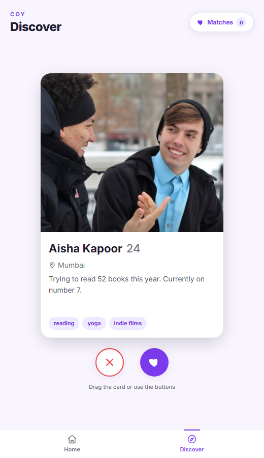
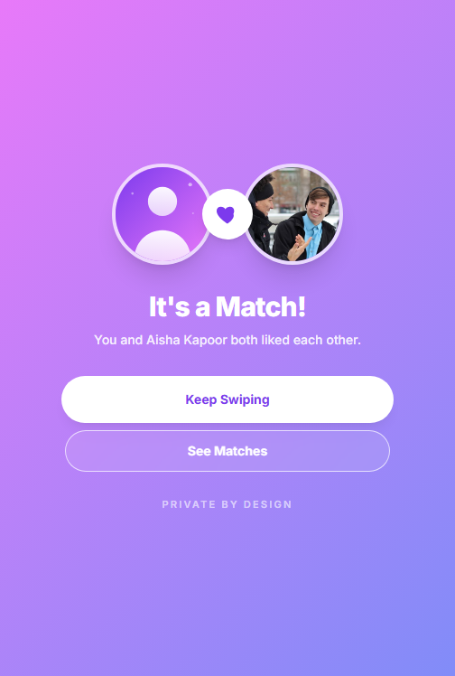

# Coy — Discover

A standalone, mobile-first implementation of a **Discover** tab for Coy: swipe-based profile discovery, mutual-only matching, and a private matches list.

The app has two tabs:

- **Home** — intentionally blank, matching the assignment.
- **Discover** — the full swipe experience.

No authentication. A single logged-in user is hardcoded as `user_me`.

| Discover | Instant match |
| --- | --- |
|  |  |

---

## Tech stack

- **Next.js 15** (App Router) + **React 19** + **TypeScript** (strict)
- **Tailwind CSS**
- **Framer Motion** for card gestures and transitions
- **SQLite** via `better-sqlite3`
- **Vitest** for backend and UI tests (`jsdom` + Testing Library)

Node **22+** is required (`better-sqlite3` native module).

---

## Setup

```bash
npm install
npm run dev
```

Open http://localhost:3000. The database is created and seeded automatically on the first API request.

### Scripts

| Command | Description |
| --- | --- |
| `npm run dev` | Start the development server |
| `npm run build` | Production build |
| `npm start` | Start the production server |
| `npm run lint` | ESLint |
| `npm run typecheck` | `tsc --noEmit` |
| `npm test` | Run the Vitest suite |
| `npm run test:watch` | Vitest in watch mode |
| `npm run db:reset` | Delete the DB and its WAL/SHM/journal files |

For a clean demo, run `npm run db:reset` while the dev server is stopped, then start it again.

---

## Seed data

- **30 profiles** with name, age, photo, bio, city, and 3–5 interests.
- Photos use `https://i.pravatar.cc/400?img=N` with a local fallback.
- **8 profiles already liked `user_me`** at seed time, so a demo match can fire immediately.

Seeding is idempotent and runs lazily on first DB access. The DB lives at `data/coy.db` by default, or at `COY_DB_PATH` if set. `data/` and `*.db*` are gitignored.

### Demo tip: instant matches

These profiles have already liked the logged-in user. Swipe right on any of them to see the match screen immediately:

| ID | Name |
| --- | --- |
| p01 | Aisha Kapoor |
| p04 | Kabir Singh |
| p07 | Sneha Pillai |
| p11 | Tanvi Desai |
| p15 | Nisha Kulkarni |
| p19 | Kritika Shah |
| p23 | Swati Agarwal |
| p27 | Pallavi Singh |

This list is developer/demo documentation only. It is never exposed through the UI or API.

---

## API

All responses are JSON. The server always acts as `user_me`; no user ID is accepted from the client. GET routes send `Cache-Control: no-store`.

### `GET /api/feed`

Returns profiles that `user_me` has not yet swiped on, in deterministic seed order.

```json
[
  {
    "id": "p01",
    "name": "Aisha Kapoor",
    "age": 24,
    "photo": "https://i.pravatar.cc/400?img=1",
    "bio": "Trying to read 52 books this year. Currently on number 7.",
    "city": "Mumbai",
    "interests": ["reading", "yoga", "indie films"]
  }
]
```

- `200` → `Profile[]` (may be empty)
- `500` → `{ "error": "Failed to load feed." }`
- No inbound-like fields are included.

### `POST /api/swipe`

```json
{ "targetId": "p01", "direction": "like" }
```

- `200` → `{ "match": true, "matchCreated": true, "profile": { ... } }` on a new mutual like
- `200` → `{ "match": true, "matchCreated": false, "profile": { ... } }` for a duplicate mutual like
- `200` → `{ "match": false, "matchCreated": false }` when there is no match
- `400` → invalid body, missing/empty `targetId`, invalid direction, or self-swipe
- `404` → unknown profile
- `500` → `{ "error": "Failed to save swipe." }`

`matchCreated` (not `match`) controls the "It's a Match!" overlay, so duplicates never re-open it.

### `GET /api/matches`

Returns only confirmed mutual matches, newest first.

- `200` → `Profile[]` (may be empty)
- `500` → `{ "error": "Failed to load matches." }`

The assignment names `/feed`, `/swipe`, and `/matches`; this app implements them as `/api/feed`, `/api/swipe`, and `/api/matches`, which is the Next.js App Router convention.

---

## Privacy design

Coy's core promise is that **you never learn who liked you unless the like is mutual**.

This implementation enforces that at every layer:

1. `/api/feed` returns only profile fields — no `likedYou`, no counts, no ordering by inbound likes.
2. There is no endpoint that lists inbound likes.
3. `/api/matches` reads only from the `matches` table, which is populated only on mutual likes.
4. The feed is ordered by explicit seed order, never by who liked the user.
5. The client never receives the pre-liked IDs; they are documented only in this README.
6. The swipe response includes a profile only when a match exists.
7. The UI never shows "X people liked you" or blurred liker cards.

---

## Architecture

```
Browser
  ├── Home tab (blank)
  └── Discover tab
        ├── Swipe deck (top 2 cards rendered)
        ├── Match overlay
        └── Matches view + profile bottom sheet
                │ fetch JSON
                ▼
Next.js route handlers (thin: validate → call repo → respond)
  ├── GET  /api/feed
  ├── POST /api/swipe
  └── GET  /api/matches
                │
                ▼
lib/repo.ts   testable DB operations
lib/db.ts     lazy singleton connection, schema, seed
SQLite        data/coy.db
```

Key decisions:

- Business logic lives in `lib/repo.ts`, not in route handlers, so it is directly testable.
- Swipes use a composite primary key, so duplicate swipes are ignored at the DB level.
- Matches use one canonical row per pair (`user_a_id < user_b_id`).
- Swipe recording and match creation run in one transaction.
- The stored swipe direction is read back before matching; a stored `pass` stays authoritative.
- The client records a swipe first, advances the deck only after success, and keeps the card on failure.
- One in-flight swipe lock prevents double-tap skips.
- Stale feed responses are cancelled with `AbortController`.

---

## Testing

```bash
npm test
```

The suite uses an in-memory SQLite database for the backend tests and `jsdom` with a mocked API client
and motion layer for the UI tests. It covers:

- 30 profiles and 8 inbound likes seeded; idempotent re-seeding
- Feed exclusion after pass/like
- One-way like → no match
- Mutual like → exactly one canonical match
- Duplicate like → no duplicate match, `matchCreated: false`
- Stored `pass` then later `like` → no match
- Matches never include one-sided likes
- Feed payload contains no liker metadata
- API status codes: `400`, `404`, `200`
- Persistence across database reopen
- Database-level self-swipe rejection
- Match overlay opens only when `matchCreated` is true
- Duplicate mutual match does not reopen the overlay
- Failed swipe keeps the card and shows an error toast
- Both action buttons are disabled while a swipe is in flight
- Empty state appears after the last card is passed
- Keep Swiping closes the overlay and leaves the deck usable
- See Matches opens the matches view from the overlay
- Matches fetch failure keeps Discover usable
- Match cards are deduplicated by profile id

Before submitting:

```bash
npm run lint
npm run typecheck
npm test
npm run build
```

---

## Deployment

SQLite with `better-sqlite3` needs a **Node host with a persistent disk**: a VPS, Railway, Fly.io, or Render with a volume.

**Vercel serverless is not suitable** for this data layer: the filesystem is ephemeral/read-only and the native module may fail. If a hosted demo is required, either deploy to a Node host with a volume or replace SQLite with Turso/libsql or Postgres.

For a local demo:

```bash
npm run db:reset
npm run dev
```

Then open Discover and swipe right on Aisha (p01) to trigger a match.

---

## Known limitations

- Single hardcoded user (`user_me`), no authentication.
- No chat or messaging.
- No pagination; 30 profiles are returned in one feed request.
- External placeholder photos depend on `i.pravatar.cc`; a local fallback is used if an image fails.
- The demo is intended to run locally or on a persistent Node host.
